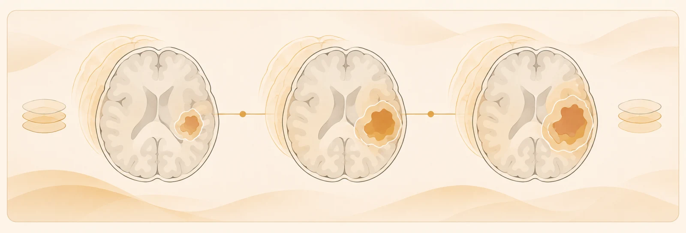
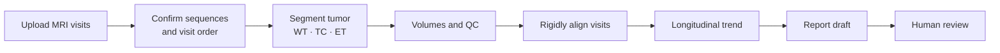

<h1 align="center">ClinAgent GBM</h1>

<p align="center">
  <strong>A prototype for coordinating longitudinal brain-tumor MRI research workflows.</strong>
</p>

<p align="center">
  
  <a href="LICENSE"></a>
  
  
</p>

<p align="center">
  <a href="#quick-start">Quick Start</a> ·
  <a href="#gbm-workflow">GBM Workflow</a> ·
  <a href="#evaluation">Evaluation</a> ·
  <a href="#configuration">Configuration</a> ·
  <a href="#citation">Citation</a>
</p>

<p align="center">
  
</p>

**ClinAgent GBM** is the glioblastoma and brain-tumor workspace in ClinAgent. Upload **1 to 6 visits** of T1, T1c, T2 and FLAIR MRI, run tumor segmentation through a configured service, review WT / TC / ET volumes with quality control, rigidly align visits, and follow longitudinal trends. Report drafts require human review before handoff.

> [!IMPORTANT]
> **Research use only.** ClinAgent is not a medical device, has not been cleared for clinical use, and must not be used for diagnosis or treatment decisions. Every output requires review by a qualified professional.

## Highlights

- **Review MRI together.** Linked axial, coronal and sagittal views, side-by-side comparisons, per-panel sequence selection and hold-to-hide masks.
- **Track change across visits.** Segmentation-derived volumes, QC warnings and rigid alignment to a chosen reference visit. Unmeasured visits are never plotted as zero.
- **Draft for human review.** Findings and impression stay separate from QC and provenance. LLM report requests contain only allowlisted, de-identified measurements and QC fields, never images, dates or identifiers.
- **Bring the model to the data.** Works with self-hosted models through any OpenAI-compatible endpoint. With Muse-Glimmer-30B, ClinAgent GBM completed all 65 cases of a public glioblastoma evaluation, and every reported volume matched the tool measurements ([details](#evaluation)).

## Quick Start

ClinAgent needs Python 3.10+ and an API key for at least one LLM provider. The browser UI ships prebuilt inside the package, so Node.js is only needed if you change the frontend.

```bash
git clone https://github.com/lanqz7766/Open-ClinAgent.git
cd Open-ClinAgent

python3 -m venv .venv && source .venv/bin/activate
pip install -e ".[dev]"

cp .env.example .env      # then add your provider key, e.g. OPENAI_API_KEY
clinagent --doctor        # check configuration
clinagent --serve         # start the gateway and UI
```

Open <http://127.0.0.1:3000/demo>. Use `clinagent --serve --port <port>` to pick another port.

Or install the package directly:

```bash
pip install "clinagent @ git+https://github.com/lanqz7766/Open-ClinAgent.git"
```

`clinagent` loads `.env` automatically from the working directory or its parent. Do not `source .env` in your shell; some values are valid for `.env` parsing but not shell-safe.

### What runs out of the box

| Component | Included | Needs your own setup |
| --- | --- | --- |
| Agent runtime, gateway, browser UI | Yes | An LLM provider key |
| EHR and imaging connectors | Mock mode by default | A FHIR / DICOMweb endpoint for live data |
| Tumor and structural segmentation | Client and tool wrappers only | Segmentation service and model weights, neither included |
| MRI cases | No imaging data included | De-identified data you are permitted to use |
| Rigid registration | With `pip install -e ".[preview]"` | Nothing else |

## GBM Workflow



Upload NIfTI files, folders or ZIP archives and confirm the modality mapping. Timelines use confirmed scan dates or explicit relative days. Alignment supports comparison across visits; native segmentation volumes remain the report source.

## Evaluation

We tested whether a language model running inside ClinAgent GBM can complete the longitudinal workflow on public data. The cohort is 65 glioblastoma patients from [LUMIERE](https://doi.org/10.1038/s41597-022-01881-7), each with two MRI visits of T1, T1c, T2 and FLAIR. For every patient, the model had to request new segmentations for both visits, review their QC results, compare three tumor regions and submit a structured report. No precomputed answers were provided. All models used the same harness, segmentation model, inputs and scoring rules.

| Model | Task success | Numeric fidelity | Mean / P95 time (s) |
| --- | --- | --- | --- |
| **Muse-Glimmer-30B** | **65/65 (100%)** | **780/780 (100%)** | **14.9 / 21.2** |
| gpt-5.6-luna | 65/65 (100%) | 780/780 (100%) | 16.8 / 19.2 |
| gemma4-v2-Q4_K_M | 61/65 (93.8%) | 743/780 (95.3%) | 16.1 / 18.8 |

- **Task success.** Both segmentations obtained, passing QC reviewed, and a complete three-region report with correct values, directions and measurement sources. One round of formatting feedback is allowed.
- **Numeric fidelity.** 65 patients × 3 regions × 4 values (prior volume, follow-up volume, change, percent change), checked against volumes computed independently from the masks generated in each run.
- **Time.** The full workflow from task start to final report, including segmentation. Serving hardware and sampling differed across models, so times are indicative.

This is an early study on a development cohort. One additional patient was excluded after review because both segmentations were empty for every model. The benchmark measures tool use, evidence transfer and report completion; segmentation accuracy and clinical interpretation need separate reference standards.

## Architecture

The browser UI, CLI and API share a **FastAPI + WebSocket gateway**. A workflow router selects a clinical family and scenario, then runs tools through a multi-provider ReAct agent runtime. Markdown skills guide reasoning; JSON scenario contracts define task entry points.

The runtime lives in [`src/clinagent/`](src/clinagent/), UI source in [`frontend/`](frontend/), and extensions in [`skills/`](skills/) and [`scenarios/`](scenarios/). See [CONTRIBUTING.md](CONTRIBUTING.md) to contribute.

**Also in this repository:** general Neuro MRI, RadOnc, Findings, Queue, Diagnosis, Screening and Safety families.

## Configuration

Set your provider key and model in `.env`, using [`.env.example`](.env.example) as the template. ClinAgent loads it automatically.

| Setting | Variables |
| --- | --- |
| LLM provider | `PROVIDER`, `OPENAI_API_KEY`, `OPENAI_MODEL`, or `GEMINI_API_KEY`, `GEMINI_MODEL` |
| Local or compatible LLM | `OPENAI_BASE_URL`, `OPENAI_MODEL`, `OPENAI_API_KEY` |
| Tumor segmentation | `CLINAGENT_TUMOR_SEGMENTATION_SERVICE_URL`, `CLINAGENT_TUMOR_SEGMENTATION_MODEL_ID` |

Local models work through **any OpenAI-compatible endpoint**. Provider examples are in [`examples/`](examples/). Tumor segmentation requires your own configured HTTP service and model weights.

Docker deployment files are in [`deploy/`](deploy/).

## Acknowledgments

The agent runtime in `src/clinagent/engine/` is adapted from [ClawAgents](https://github.com/x1jiang/clawagents_py) by Xiaoqian Jiang, used under the MIT License. The original copyright and license notice is kept in [src/clinagent/engine/LICENSE-clawagents](src/clinagent/engine/LICENSE-clawagents).

## Citation

If you use ClinAgent in your research, please cite:

```bibtex
@software{lan2026clinagent,
  author  = {Lan, Qizhen},
  title   = {{ClinAgent}: A Clinical {AI} Agent Platform for Structured, Review-Ready Imaging Workflows},
  year    = {2026},
  version = {0.2.1},
  url     = {https://github.com/lanqz7766/Open-ClinAgent}
}
```

Citation metadata is also available in [CITATION.cff](CITATION.cff).

## License

Released under the [MIT License](LICENSE).
