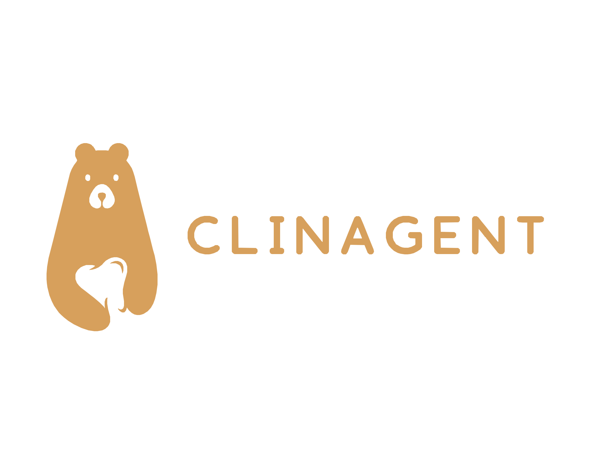
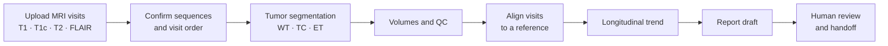
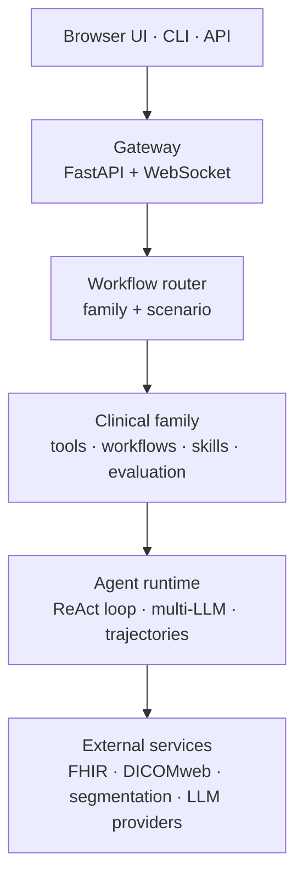

<p align="center">
  
</p>

<p align="center">
  <b>An open-source clinical AI agent platform for structured, review-ready imaging workflows.</b>
</p>

<p align="center">
  <a href="https://www.python.org"></a>
  <a href="LICENSE"></a>
  
  
</p>

<p align="center">
  <a href="#quick-start">Quick Start</a> ·
  <a href="#brain-tumor-workspace">Brain Tumor Workspace</a> ·
  <a href="#architecture">Architecture</a> ·
  <a href="#configuration">Configuration</a> ·
  <a href="#citation">Citation</a>
</p>

---

ClinAgent routes each clinical task to a specialized **family**: a bundle of tools, workflows, evaluation logic and presentation for one clinical domain. Advisory **skills** written in Markdown shape how the agent reasons and formats its output, and **scenario contracts** in JSON define reproducible, auditable task entry points. A browser workspace sits on top for imaging review, longitudinal tracking and report drafting.

The flagship workflow is a **brain tumor (glioma) workspace** for longitudinal MRI review: sequence confirmation, tumor segmentation, sub-region volumes, QC, alignment across visits and human-reviewed report drafting.

> [!IMPORTANT]
> ClinAgent is research software. It is not a medical device, has not been cleared for clinical use, and must not be used for diagnosis or treatment decisions. Every output requires review by a qualified professional.

## Highlights

- **Brain tumor workspace.** Upload one to six MRI visits (T1, T1c, T2, FLAIR), run tumor segmentation through a configured service, review WT / TC / ET volumes with QC warnings, and draft reports that a human must review before handoff.
- **Linked multi-view MRI viewer.** Axial, coronal and sagittal views with linked navigation, side-by-side comparison panels, per-panel sequence choice and a hold-to-hide mask control.
- **Longitudinal review.** Visit timelines that use real scan dates or explicit relative days, never inferred dates, with rigid alignment (SimpleITK, six degrees of freedom) to a chosen reference visit.
- **Multi-LLM agent runtime.** A ReAct loop with loop detection, context budgeting and trajectory recording, running on OpenAI, Azure OpenAI, Gemini, Claude, Bedrock, Ollama or vLLM.
- **Pluggable clinical knowledge.** Add a `SKILL.md` or a scenario JSON to change agent behavior without touching runtime code.
- **Standards-based connectors.** FHIR R4, DICOMweb and SMART on FHIR (OAuth2 PKCE), with mock connectors so everything runs without hospital systems.

## Quick Start

ClinAgent needs Python 3.10+ and an API key for at least one LLM provider. The browser UI ships prebuilt inside the package, so Node.js is only needed if you change the frontend.

```bash
git clone https://github.com/lanqz7766/Open-ClinAgent.git
cd Open-ClinAgent

python3 -m venv .venv && source .venv/bin/activate
pip install -e ".[dev]"

cp .env.example .env      # then add your provider key, e.g. OPENAI_API_KEY
clinagent --doctor        # check configuration
clinagent --serve         # start the gateway and UI
```

Open <http://127.0.0.1:3000/demo>. Use `clinagent --serve --port <port>` to pick another port.

Or install the package directly:

```bash
pip install "clinagent @ git+https://github.com/lanqz7766/Open-ClinAgent.git"
```

`clinagent` loads `.env` automatically from the working directory or its parent. Do not `source .env` in your shell; some values are valid for `.env` parsing but not shell-safe.

### What runs out of the box

| Component | Included | Needs your own setup |
| --- | --- | --- |
| Agent runtime, gateway, browser UI | Yes | An LLM provider key |
| EHR and imaging connectors | Mock mode by default | A FHIR / DICOMweb endpoint for live data |
| Brain tumor and structural segmentation | Client and tool wrappers | A segmentation service and model weights ([details](#segmentation-services)) |
| MRI cases | No imaging data is distributed | De-identified data you are permitted to use |
| Rigid registration | Yes, with `pip install -e ".[preview]"` | Nothing else |

## Brain Tumor Workspace



- **Upload.** NIfTI ZIP archives, files or folders, with an editable modality mapping. ZIP archives are extracted in the browser and only mapped NIfTI files plus confirmed visit metadata are sent to the server. Nothing infers patient identity or exam dates from the images.
- **Measurements.** Model masks drive all quantitative measurements. Unmeasured visits are never plotted as zero.
- **Alignment.** Input checks, optional N4 bias-field correction, within-visit rigid alignment to T1c, cross-visit alignment to the reference T1c, and resampling with QC. Native segmentation volumes remain the report source.
- **Reports.** Findings and impression are kept separate from QC and provenance. Report requests to an LLM contain only allowlisted, de-identified measurements and QC fields, never images, dates or identifiers. If the model fails, the workspace shows a clearly labeled structured local draft.

## Clinical Families

| Family | What it does | Status |
| --- | --- | --- |
| **Neuro** | Brain tumor workspace, structural MRI review, segmentation, volumetrics, longitudinal tracking | Flagship |
| **RadOnc** | DVH-based plan review, OAR tolerance checks, LLM-assisted trade-off summaries | In development |
| **Findings** | Actionable findings closure and follow-up tracking | Active |
| **Queue** | Worklist triage and prioritization | Active |
| **Diagnosis** | Missed diagnosis detection across prior studies | Active |
| **Screening** | Screening gap detection and closure | Active |
| **Safety** | Radiation safety event monitoring | Active |

## Architecture



```
src/clinagent/
├── engine/        Agent runtime: ReAct loop, LLM providers, tools, trajectories
├── platform/      Shared services: registry, config, persistence, workflow engine
├── families/      Clinical domains: neuro, radonc, findings, queue, ...
├── connectors/    FHIR, DICOMweb, SMART on FHIR
├── gateway/       FastAPI + WebSocket server, auth, upload and job workers
├── console/       CLI interface
└── ui/demo-next/  Prebuilt browser UI

frontend/          React + TypeScript + Vite source for the UI
skills/            Advisory skills in Markdown (14 bundled)
scenarios/         Scenario contracts in JSON
workflows/         Workflow definitions
deploy/            Dockerfile and Compose files
examples/          Provider and integration examples
```

## Configuration

Copy `.env.example` to `.env`. `CLINAGENT_ENV_FILE` can point to another env file.

| Area | Variables |
| --- | --- |
| Provider | `PROVIDER`, `OPENAI_API_KEY`, `OPENAI_MODEL`, `OPENAI_BASE_URL`, `OPENAI_API_VERSION`, `GEMINI_API_KEY`, `GEMINI_MODEL` |
| LLM tuning | `MAX_TOKENS`, `TEMPERATURE`, `CONTEXT_WINDOW`, `STREAMING` |
| Trajectories | `CLAW_TRAJECTORY`, `CLAW_RETHINK`, `CLAW_LEARN`, `CLAW_PREVIEW_CHARS`, `CLAW_RESPONSE_CHARS` |
| Local data roots | `CLINAGENT_NEURO_REPORT_DATA_ROOT`, `CLINAGENT_NEURO_LONGITUDINAL_DATA_ROOT`, `CLINAGENT_RADONC_DEMO_ROOT` |
| Skills and uploads | `CLINAGENT_SKILLS_DIRS`, `CLINAGENT_LOCAL_UPLOAD_DIR` |
| Segmentation | `CLINAGENT_NNUNET_SERVICE_URL`, `CLINAGENT_NNUNET_TIMEOUT_S`, `CLINAGENT_NNUNET_MODEL_ID`, `CLINAGENT_SEGMENTATION_TOOL_REMOTE_HOST`, `CLINAGENT_SEGMENTATION_TOOL_REMOTE_ROOT`, `CLINAGENT_SEGMENTATION_TOOL_GPU_ID`, `CLINAGENT_TUMOR_SEGMENTATION_SERVICE_URL`, `CLINAGENT_TUMOR_SEGMENTATION_TIMEOUT_S`, `CLINAGENT_TUMOR_SEGMENTATION_MODEL_ID` |

Local models work through any OpenAI-compatible endpoint, for example Ollama with `OPENAI_BASE_URL=http://localhost:11434/v1`. See `examples/` for OpenAI, Gemini, Azure, Ollama, vLLM and Bedrock.

## Advanced Setup

### Segmentation services

Model weights and GPU inference are not part of this repository. ClinAgent talks to segmentation services over HTTP, so you can run them on any machine you control.

<details>
<summary><b>Brain tumor segmentation</b></summary>

The tumor segmentation tool is separate from the structural brain segmentation service and should not be described as a diagnostic model. Expected inputs are BraTS-style NIfTI files: `t1n` (native T1), `t1c` (contrast-enhanced T1), `t2w` (T2-weighted) and `t2f` (FLAIR).

```bash
CLINAGENT_TUMOR_SEGMENTATION_SERVICE_URL=http://127.0.0.1:<port>
CLINAGENT_TUMOR_SEGMENTATION_MODEL_ID=<your-model-id>
# CLINAGENT_TUMOR_SEGMENTATION_API_KEY=<bearer-token-if-protected>
```

The agent tool `run_brain_tumor_segmentation` returns a segmentation NIfTI plus derived `tumor_regions.json`, `volumes.csv` and `overlay_preview.png` artifacts. Smoke test the tool wrapper:

```bash
python -m clinagent.families.neuro.run_tumor_segmentation_tool \
  --t1c-nifti-path /absolute/path/to/case_t1c.nii.gz \
  --t2f-nifti-path /absolute/path/to/case_t2f.nii.gz \
  --output-dir /absolute/path/to/tumor_segmentation_outputs
```

For predictable latency, use a persistent nnU-Net runtime with startup warmup. The service should expose `/live` for process health and `/ready` for model readiness. `CLINAGENT_TUMOR_SEGMENTATION_WARMUP_MODALITIES_JSON` may point to a deployment-local, de-identified four-modality mapping used for one warmup inference; never commit that mapping or its image paths.

</details>

<details>
<summary><b>Remote services through an SSH tunnel</b></summary>

If a service runs on another machine and is only reachable there on `127.0.0.1`, keep a local SSH tunnel open and point ClinAgent at the forwarded port:

```bash
CLINAGENT_NNUNET_SERVICE_URL=http://127.0.0.1:18000
CLINAGENT_SEGMENTATION_TOOL_REMOTE_HOST=<ssh-host-alias>
CLINAGENT_SEGMENTATION_TOOL_REMOTE_ROOT=/tmp/clinagent-segmentation
```

```bash
./scripts/segmentation_tunnel.sh start     # tmux when available, else ssh -f -N
./scripts/segmentation_tunnel.sh status
curl -fsS http://127.0.0.1:18000/health
```

Reuse the same helper for the tumor service with `CLINAGENT_SEGMENTATION_LOCAL_PORT`, `CLINAGENT_SEGMENTATION_REMOTE_PORT`, `CLINAGENT_SEGMENTATION_REMOTE_HOST` and `CLINAGENT_SEGMENTATION_TMUX_SESSION`. On macOS, `./scripts/install_segmentation_tunnel_watchdog.sh install` restores the tunnel after VPN reconnects. Configure hosts through environment variables or your own SSH config.

</details>

### Deployment

<details>
<summary><b>Invitation-only physician preview with Docker Compose</b></summary>

The preview accepts de-identified research images only. Run the gateway together with one durable queue worker:

```bash
CLINAGENT_PREVIEW_SCOPE=brain_tumor
CLINAGENT_PHYSICIAN_CURATED_ONLY=true
CLINAGENT_BRAIN_TUMOR_CURATED_CASE_IDS=<comma-separated-deployment-case-ids>
CLINAGENT_BRAIN_TUMOR_DURABLE_QUEUE=true

clinagent-brain-tumor-service
clinagent-brain-tumor-worker
```

The worker serializes GPU reruns through the auth SQLite database, so reruns survive gateway restarts and stay scoped to the requesting account. Leave `CLINAGENT_PREVIEW_SCOPE` unset or set it to `full` for the complete navigation.

Build a release from a clean, committed worktree, then build the image with the values from `release.json`:

```bash
npm --prefix frontend run build
.venv/bin/python -m pytest -q
.venv/bin/python scripts/check_boundary_compliance.py
.venv/bin/python scripts/build_preview_release.py --output .clinagent/releases

docker build -f deploy/Dockerfile \
  --build-arg GIT_COMMIT="$GIT_COMMIT" \
  --build-arg RELEASE_ID="$RELEASE_ID" \
  --build-arg BUILD_TIME="$BUILD_TIME" \
  -t "clinagent:$RELEASE_ID" .
```

`deploy/compose.yaml` runs the gateway, a durable queue worker and daily online SQLite backups. Containers use a non-root identity, a read-only application filesystem, bounded logs and automatic restart. Set these variables in a private file outside Git:

| Variable | Purpose |
| --- | --- |
| `CLINAGENT_IMAGE` | Exact release image tag, never `latest` |
| `CLINAGENT_RUNTIME_ENV_FILE` | Private application configuration and provider/SMTP credentials |
| `CLINAGENT_STATE_DIR` | Dedicated writable state directory |
| `CLINAGENT_CURATED_DATA_DIR` | Read-only de-identified data mounted at `/data/curated` |
| `CLINAGENT_RUN_UID`, `CLINAGENT_RUN_GID` | Owner of the writable state directory |
| `CLINAGENT_HTTP_PORT` | Unused host port; binds to loopback by default |
| `CLINAGENT_COOKIE_NAME` | Unique session cookie name per environment |
| `CLINAGENT_PREVIEW_SCOPE` | Defaults to `brain_tumor`; use `full` only for validated internal deployments |

```bash
docker compose --env-file "$COMPOSE_CONFIG" -p clinagent-preview -f deploy/compose.yaml up -d
```

For Docker-managed HTTPS, add `-f deploy/compose.https.yaml` and set `CLINAGENT_TLS_CERT`, `CLINAGENT_TLS_KEY` and `CLINAGENT_HTTPS_PORT`. Otherwise put an HTTPS reverse proxy in front of the loopback gateway, sized for 1 GB uploads. Secure cookies are on by default; set `CLINAGENT_COOKIE_SECURE=false` only for a private loopback staging environment.

Model weights and GPU inference dependencies are not included in the image. Provide a validated private model service; the gateway and inference service must see shared input/output paths identically. Automated tests and a healthy container do not establish clinical readiness.

</details>

<details>
<summary><b>Accounts and access control</b></summary>

In authenticated deployments, the general agent, developer console and shared workflow APIs require an administrator account. Administrator roles are issued only through the CLI:

```bash
clinagent-auth create-user --email operator@example.org --name Operator --role admin
```

The command prompts for the initial password; `--password-stdin` supports automation. New accounts must replace the initial password and accept the research-use agreement before accessing clinical workflows. Administrators can add users, suspend access and reset initial passwords from the **Accounts** page, or with `clinagent-auth list-users`, `set-status` and `reset-password`. `clinagent-auth invite` sends a 72-hour single-use invitation when SMTP is configured (`CLINAGENT_SMTP_HOST`, `CLINAGENT_SMTP_FROM`, `CLINAGENT_PUBLIC_URL`).

Neuro sessions, slices, CSV exports and viewer assets require ownership. Shared examples must be listed explicitly in `CLINAGENT_NEURO_CURATED_PATIENT_IDS`.

</details>

<details>
<summary><b>Self-hosted LLM for report drafting</b></summary>

Report drafting uses the same provider interface as the rest of the application, including OpenAI-compatible endpoints configured with `OPENAI_BASE_URL`, `OPENAI_MODEL` and `OPENAI_API_KEY`. A failed private endpoint never falls back silently to a cloud endpoint. Validate a model's structured tool calls, latency and report fidelity before enabling it for readers, and do not expose its inference port.

</details>

<details>
<summary><b>Sharing upload examples</b></summary>

Package only images explicitly approved for sharing. Header cleaning does not remove identifiers burned into image pixels; the administrator remains responsible for de-identification and redistribution permission.

```bash
python -m clinagent.gateway.preview_examples \
  --output "$APPROVED_EXAMPLES_DIR" --id example_01 --approved-deidentified \
  --t1n "$T1_FILE" --t1c "$T1C_FILE" --t2w "$T2_FILE" --t2f "$FLAIR_FILE"
```

For longitudinal examples, pass repeated `--visit "$T1_FILE" "$T1C_FILE" "$T2_FILE" "$FLAIR_FILE"` groups in chronological order. Set `CLINAGENT_UPLOAD_EXAMPLES_ROOT` to the published directory. Only archives listed in `catalog.json` are downloadable, and listing and download both require sign-in.

</details>

### Research modules

<details>
<summary><b>Volumetric reference tables</b></summary>

Neuro volumetric references are kept in two layers. `configs/normative_brain_volumes_master.csv` is the reviewable source of truth, with one row per ROI, sex, age band and source, including provenance and review state. `configs/normative_brain_volumes.json` is generated from it and publishes only rows that are approved, Tier A, sample-size qualified and label-mappable. The runtime table is intentionally conservative and may publish zero ROI buckets until reviewed references are added.

```bash
python3 scripts/build_normative_reference_table.py
```

Do not describe these references as a validated clinical normative database without cohort-specific verification, appropriate ICV/TIV handling and scanner or site harmonization.

</details>

<details>
<summary><b>MR-RATE knowledge service</b></summary>

The gateway can proxy an external MR-RATE-compatible, read-only knowledge service. The gateway never needs direct access to raw mounted data.

```bash
CLINAGENT_MR_RATE_BASE_URL=http://127.0.0.1:18120
CLINAGENT_MR_RATE_LOCAL_ROOT=/absolute/path/to/local/mr-rate-mirror
```

`./scripts/mr_rate_knowledge_tunnel.sh start` opens a tunnel to a remote service. The proxy is exposed under `/api/neuro-knowledge/*`, and the Knowledge Explorer lives at `/demo/analysis/neuro-knowledge`. With a local mirror configured, selected studies are downloaded on demand and can be opened in Neuro Analysis.

</details>

<details>
<summary><b>Local launchers</b></summary>

`./scripts/start_gateway_local.sh` stops an older local ClinAgent on the same port, rebuilds the UI only when needed and starts the gateway. Set `CLINAGENT_LOCAL_PORT` to change the port and `CLINAGENT_BUILD_UI=1` or `0` to force or skip the UI build.

`./scripts/start_demo_single_entry.sh` starts the gateway together with the segmentation and MR-RATE tunnels behind `http://127.0.0.1:3000/demo`.

</details>

## Development

```bash
pip install -e ".[dev,preview]"
python -m pytest -q
python scripts/check_boundary_compliance.py

cd frontend && npm install && npm run build   # only when changing the UI
```

Rebuilding the frontend writes the bundled UI to `src/clinagent/ui/demo-next/`; commit that output together with the source change.

## Contributing

Contributions from clinicians, researchers and engineers are welcome. The easiest places to start:

1. **Add a skill.** Write a `SKILL.md` that improves agent reasoning in your specialty.
2. **Add a scenario.** Define a new workflow contract in `scenarios/`.
3. **Extend a family.** Add tools, workflows or evaluation logic to an existing clinical domain.

See [CONTRIBUTING.md](CONTRIBUTING.md). Never commit `.env` files, API keys, patient data or imaging files, and run `scripts/check_boundary_compliance.py` before opening a pull request.

## Acknowledgments

The agent runtime in `src/clinagent/engine/` is adapted from [ClawAgents](https://github.com/x1jiang/clawagents_py) by Xiaoqian Jiang, used under the MIT License. The original copyright and license notice is kept in [src/clinagent/engine/LICENSE-clawagents](src/clinagent/engine/LICENSE-clawagents).

## Citation

If you use ClinAgent in your research, please cite:

```bibtex
@software{lan2026clinagent,
  author  = {Lan, Qizhen},
  title   = {{ClinAgent}: A Clinical {AI} Agent Platform for Structured, Review-Ready Imaging Workflows},
  year    = {2026},
  version = {0.2.1},
  url     = {https://github.com/lanqz7766/Open-ClinAgent}
}
```

Citation metadata is also available in [CITATION.cff](CITATION.cff).

## License

Released under the [MIT License](LICENSE).
